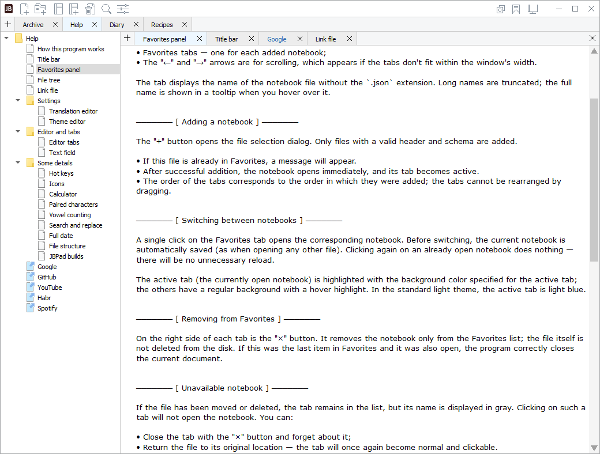
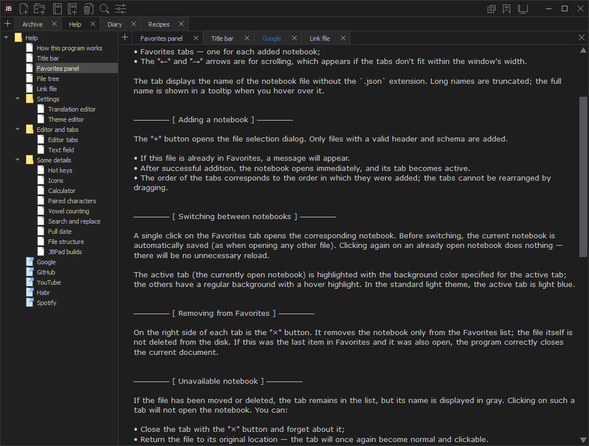
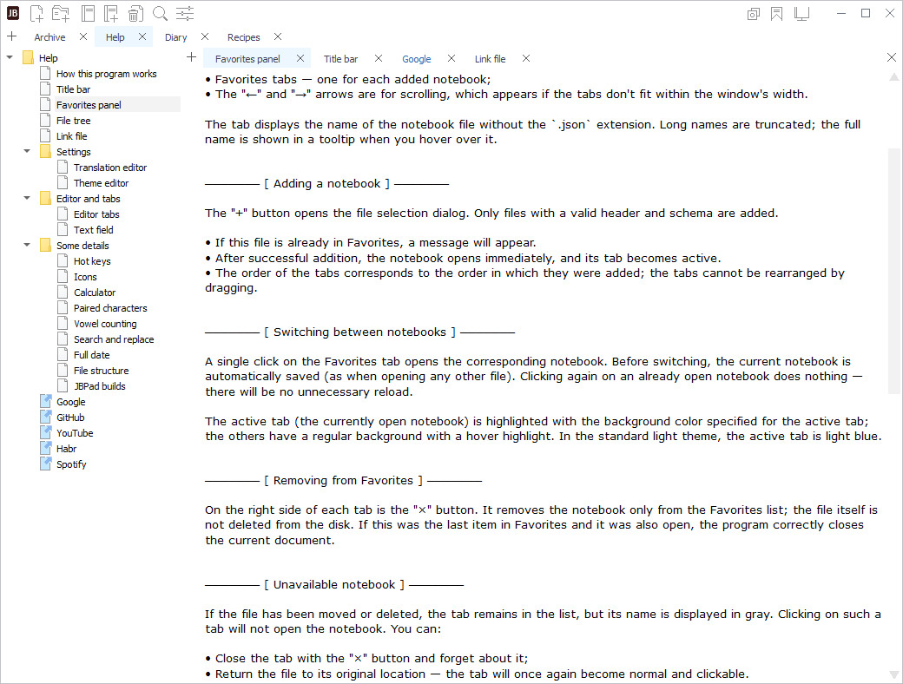

# JBPad 1.0

JBPad is a free, cross-platform, open-source text editor. Written in Python and PyQt5, it runs without installation.

**Developer:** Олег Любошенко (`somuser`)  
**Website:** https://somuser.org  
**Source code:** https://github.com/somusersoft/JBPad

[Русская версия](README.ru.md)

## Screenshots

JBPad supports different visual themes.

| Default theme | Dark theme | Light mini theme |
| --- | --- | --- |
|  |  |  |

## Features

- Organize notes in a tree and edit text in tabs.
- Multilingual interface.
- Built-in localization editor.
- Theme editor with 52 customizable parameters.
- Application data stored in JSON format.
- Web links in the tree.
- Portable data storage alongside the application.

## Supported platforms

- **Windows:** Windows 7, 8, 10, and 11.
- **Linux:** X11 and Wayland graphical environments.
- **macOS:** macOS 13.0 and later.

Build instructions and platform-specific information are available in both languages:

- [Building JBPad (English)](BUILDING.md)
- [Сборка JBPad (русский)](BUILDING.ru.md)

## Portability and data storage

JBPad is fully portable, requires no installation, and runs directly from its folder.

- `JBPad.py` — the main application source file.
- `Setting.ini` — the application settings file.
- `Data/` — application data, including localizations, themes, help notebooks, and user notebooks.
- `resources/` — application resources, including icons and cursors.
- `*.spec` — PyInstaller specification files for building on different platforms.
- `packaging/Windows/CreateInstall/` — an optional Windows installer project.

JBPad does not require installation and does not use system directories to store its settings or user data. Application settings and data are stored in the application directory.

The application was originally designed to run from removable drives such as USB flash drives. With the All_OS configuration on an exFAT-formatted drive, you can use the same copy of your data while switching between Windows 7+, Windows 10+, Linux, and macOS.

JBPad includes help notebooks in Russian and English. On the first launch, the application automatically opens the notebook corresponding to the selected interface language. These notebooks introduce the editor's features and can be edited just like regular user notebooks. If the help files are missing, the application starts without any open notebooks, allowing the user to create the first notebook manually. On subsequent launches, the application opens the last-used notebook.

## Building from source

The PyInstaller specification files are located directly in the repository root:

- `JBPad_Windows7.spec`
- `JBPad_Windows10.spec`
- `JBPad_Linux.spec`
- `JBPad_Linux_onefile.spec`
- `JBPad_macOS.spec`
- `JBPad_macOS_onefile.spec`

Choose the specification matching the target operating system and build configuration. Read the build instructions before proceeding. Run build commands from the repository root in an environment configured for the target platform.

The `*_onefile.spec` files are intended for building the application in `onefile` mode. On macOS, the output is an `.app` application bundle. These builds are used exclusively as components of the unified All_OS configuration.

## License

JBPad is distributed under the GNU General Public License version 3.0 (GPL-3.0). See [LICENSE](LICENSE).

Third-party software license notices are provided in [Licenses.txt](Licenses.txt). The repository also includes [LGPL-3.0.txt](LGPL-3.0.txt), which contains information about the applicable licenses of third-party components.

## AI-assisted development

The project was created using an AI-assisted coding approach. The code was written by AI models under my guidance: I defined the requirements, directed the development process, made design decisions, and performed the final application functionality checks.

The percentages below are approximate, subjective estimates of the contribution of the tools used at different stages of development.

- **Architecture discussions, planning, and other preparatory tasks:** ChatGPT Free — 95%; Gemini Free — 5%.
- **Code implementation:** Cursor with Composer 2 and Composer 2.5 — 85%; Cursor with ChatGPT 5.2 Medium — 14%; DeepSeek V4.1 Flash — 1%.

## Copyright

Copyright © 2026 Олег Любошенко (somuser).